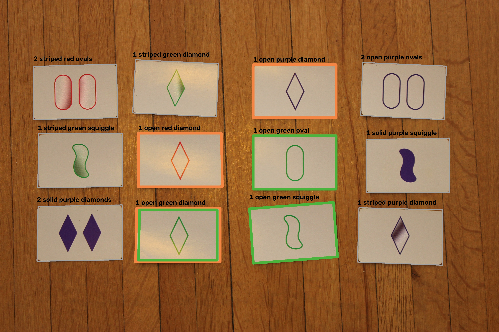

# Set, Game, Match
Computer vision for the game of Set: photograph the table, get every set.

[Set][1] is a great pattern matching game.
You put down a board of 12 cards, each of which has 4 attributes: shape, number, color, and pattern.
A set is any combination of 3 cards for which each attribute is the same (e.g., all ovals) or different (e.g., an oval, diamond, and squiggle).
The idea is to be fast and to identify sets as quickly as possible.

The [odds][2] that a randomly selected board of 12 cards contains at least one set is about 30 to 1, but it's tough to be certain that no set exists on any given board.

There are two versions of the same detector here:

* `setvision.py`, a Python module (OpenCV + NumPy), with a command-line script
* `docs/`, a static website that runs entirely in the browser and installs to a phone's home screen

## Python

	pip install -r requirements.txt
	python setgamematch.py board.jpg

prints the cards and the sets, and writes `board_labeled.jpg`.
`setgamematch_live.py` does the same on frames from your machine's camera (it needs `opencv-python` rather than the headless build, and has not been run since the rewrite).

## Website

`docs/` is plain HTML, CSS and JavaScript: no build step, no server-side code, nothing leaves the phone.
`docs/setvision.js` is a function-for-function port of `setvision.py` with no dependencies.

To try it locally:

	python3 -m http.server 8765 --directory docs

and open http://localhost:8765.

To deploy:

* **GitHub Pages**: push, then in the repository's Settings → Pages choose "Deploy from a branch", your branch, folder `/docs`.
* **Your own server**: copy the folder, e.g. `rsync -av docs/ you@host:/var/www/set/`, and serve it as static files.

Either way it has to be served over **https** for the camera button, offline use and "Add to Home Screen" to work (GitHub Pages does this for you).
On the phone, open the site, then Share → Add to Home Screen (iOS) or the install prompt (Android).

After changing anything under `docs/`, bump `CACHE` in `docs/sw.js` so installed copies drop their old offline cache.

## How it works

1. Shrink the photo and threshold on whiteness (the minimum of R, G, B) at a few levels; keep the blobs that are convex quadrilaterals of a plausible shape.
2. Warp each one to a 300x200 card.
3. Divide out the card's own background colour (a smooth surface fitted to its white parts), which removes colour casts and lighting gradients.
4. Find ink relative to the local white level, fill the outlines, and take connected components as symbols. A candidate that does not look like a Set card (ink in the wrong places, symbols off their slots, shapes unlike any symbol) is dropped.
5. Read the attributes:
   * **number** from which slots the symbols occupy, so a symbol erased by glare is still counted
   * **colour** from the hue of the strongest ink, relative to the white just outside the symbol
   * **shading** from how much ink is inside the outline compared with the outline itself, measured row by row so that fine stripes register; whether the rows alternate breaks ties when glare has faded the stripes
   * **shape** from the filled symbol's solidity and extent

## How well it works

| Photos | Cards read correctly |
| --- | --- |
| 5 board photos and 36 single-card images in this repo (`tests/evaluate.py`) | 88 / 88 |
| The same boards under 18 synthetic degradations: rotation, dim light, colour casts, blur, low resolution, heavy JPEG, noise, perspective (`tests/stress.py`) | 935 / 936 |
| 10 board photos from [nicolashahn/set-solver][5], with glare, shadows, steep angles and clutter (`tests/heldout.py`) | 125 / 126, no false cards |
| All 81 cards of a different deck, cropped, from the same source | 81 / 81 |

The first two rows are photos the detector was developed on. The last two were first run after it passed those, but then guided a round of fixes (faint stripes, shadows, glare, the box being read as a card), so they are no longer strictly unseen.
The one board card still missed is an outline almost entirely erased by glare.
The website gets the same answers as Python on all of these (`tests/js_parity.py` compares the two card by card).

Known limits:

* Cards need a background darker than they are. A white tablecloth will not work.
* Cards that touch or overlap are often missed. In a photo of all 81 cards laid edge to edge it finds 69.
* Strong glare can erase an outline or stripes completely; the app lets you tap a card to correct it.

## Tests

	python tests/evaluate.py                 # labelled photos in this repo
	python tests/stress.py                   # the same, degraded
	python tests/js_parity.py                # JavaScript port vs Python (needs node)
	git clone --depth 1 https://github.com/nicolashahn/set-solver /tmp/set-solver
	python tests/heldout.py /tmp/set-solver/image-data

`tests/margins.py` prints the range of each feature per class, which is what the thresholds in `setvision.py` were set from.
`tests/make_assets.py` regenerates the app icons and sample photo (needs Pillow), and `tests/make_explainer.py` regenerates the figures and chart data behind the "How it works" page (`docs/how.html`).

## Credits

Thanks to Nicolas Hahn ([nicolashahn/set-solver][5]) for the photos that made it possible to test this on more than one deck and table:

* `setgame1.jpeg`, `SetCards.jpeg` and `SetCards2.jpeg` in this repo are copies of photos from that project.
* The held-out evaluation (`tests/heldout.py`) and part of the charts on the "How it works" page use that project's `image-data` folder; those images are read from a clone of it, not copied here.

[1]: http://en.wikipedia.org/wiki/Set_(game)
[2]: http://norvig.com/SET.html
[5]: https://github.com/nicolashahn/set-solver
